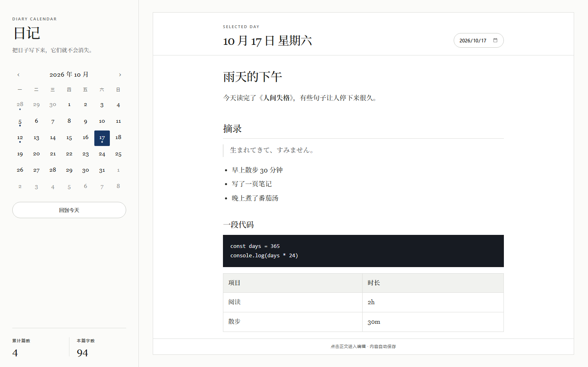
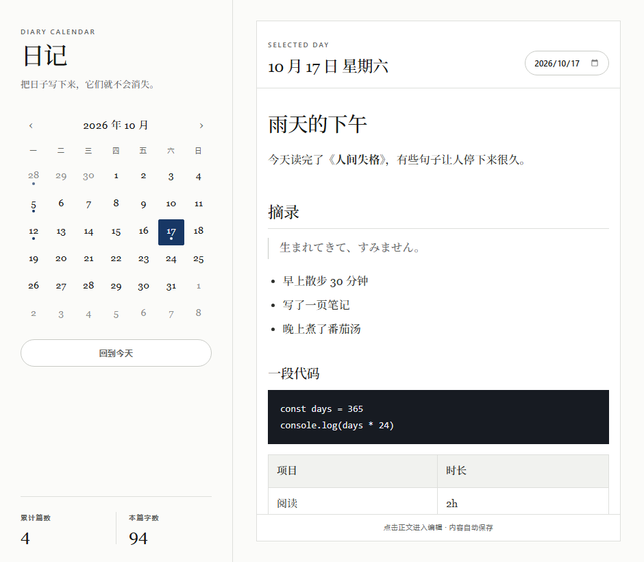
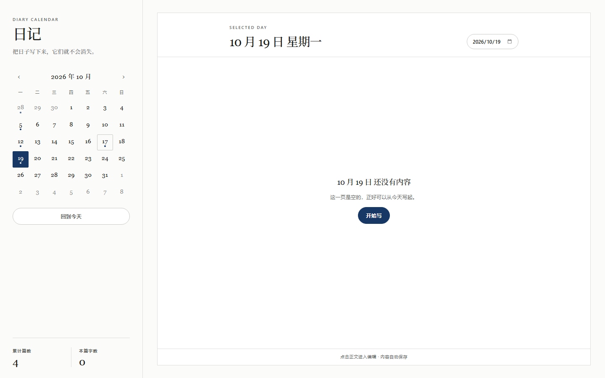
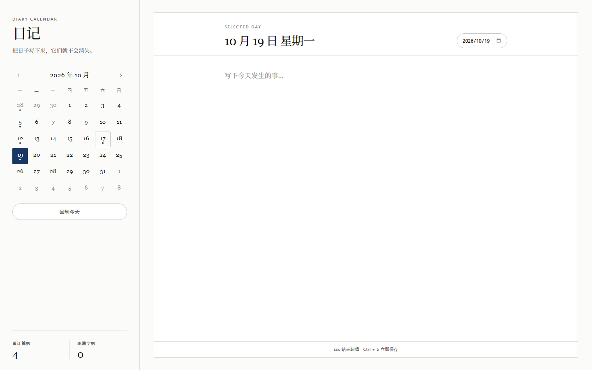

# 修复与改版说明

> 对应审查报告：[审查报告.md](审查报告.md)　|　验证证据：`review/`　|　日期：2026-10-17

本次改动分两部分：把审查报告里的 P0/P1 问题全部修掉，并按 `blog/public/css/custom.css` 的设计语言重做了整个界面。

---

## 一、界面改版：从深色玻璃拟态到纸白衬线

原来是一套深蓝夜色 + 玻璃拟态（`backdrop-filter` + 大圆角 + 投影）。现在换成博客那套**纸白 + 衬线 + 细线**的编辑排版体系，两者是两种完全不同的视觉语言，所以样式表是重写而不是微调。

### 设计令牌直接对齐博客

| 令牌 | 值 | 用途 |
| --- | --- | --- |
| `--bg` | `#fbfbf9` | 纸白底，替换原来的深色渐变 |
| `--surface` | `#ffffff` | 书写页 |
| `--text` / `--body-text` | `#171816` / `#2d2f2b` | 标题 / 正文 |
| `--muted` | `#63655f` | 次级文字 |
| `--line` / `--line-strong` | `#dedfdc` / `#c8cac5` | 1px 细线分隔 |
| `--accent` | `#173765` | 藏青，只用于选中态、链接、主按钮 |
| `--code-bg` | `#171b22` | 代码块 |

字体沿用博客的三栈：正文与标题 `Georgia / Noto Serif SC / Songti SC`，标签与按钮 `Manrope / Segoe UI / PingFang SC`，代码 `SFMono-Regular / Consolas`。

### 具体做法

- **去掉了所有 `backdrop-filter`、`box-shadow`、大圆角**。结构只靠 1px 细线和留白，跟博客一致。
- **圆角只剩两种**：`2px`（日期格）和 `999px`（按钮、日期选择器），对应博客里几乎无圆角 + 胶囊按钮的用法。
- **标题层级拉开**：日期标题 `clamp(1.45rem, 2vw, 1.9rem)`、负字距 `-0.03em`，与博客 `letter-spacing: -0.055em` 的收紧感一致。
- **章节装饰线**：Markdown 的 `h2` 加了 `border-bottom` 细线，复刻博客正文的 `h2` 样式。
- **链接**用 `border-bottom: 1px solid currentColor` 而不是下划线，颜色为藏青——博客的标志性细节。
- **Kicker 小标题**（`DIARY CALENDAR` / `SELECTED DAY`）用 0.64rem、`letter-spacing: 0.18em`、大写，对应博客的 `.section-kicker`。
- **数字全部 `tabular-nums`**：日期、篇数、字数、月份，切换时不会跳动。
- **对比度比博客更严一点**：博客的小字用的是 `--faint: #9a9c98`（约 2.7:1），在日记里日期是**可点击控件**，所以正文级小字统一用 `--muted: #63655f`（约 5.6:1），`--faint` 只留给非文字元素。这样既保留了编辑气质，也过了 WCAG AA。
- **`prefers-reduced-motion`** 全局降级过渡，博客里有，这里补上。

### 布局也重排了

| 位置 | 改法 |
| --- | --- |
| 侧栏 | 340px，靠右细线与正文区分；品牌区、月历、页脚统计用 `margin-top: auto` 分三段，不再有卡片堆叠 |
| 正文页 | 白纸 + 1px 边框，`--reading-width: 720px` 居中；面板标题与正文**同宽同起点**对齐 |
| 日历头部 | `‹ 2026 年 10 月 ›`，月份 `white-space: nowrap`，彻底解决换行 |
| 日期格 | 数字 + 固定预留 4px 的圆点位，**圆点不再压住数字**；选中为藏青实心块，今天为细线框 |
| 编辑页脚 | 增加一行状态提示：`Esc 结束编辑 · Ctrl + S 立即保存` / `点击正文进入编辑 · 内容自动保存` |

---

## 二、问题修复对照

### P0 · 数据与安全

| 编号 | 原问题 | 修法 | 位置 |
| --- | --- | --- | --- |
| P0-1 | 点链接会把应用导航走，远程页面还能拿到日记接口 | `will-navigate` 拦截 + `setWindowOpenHandler` 拒绝新窗口，统一转 `shell.openExternal`；Markdown 链接加 `target=_blank` / `rel=noopener noreferrer` | `electron/main.cjs`、`src/App.vue` |
| P0-2 | 关窗丢掉最后 240ms 输入 | 主进程 `close` 时 `preventDefault`，向渲染层发 `app:flush`，渲染层落盘后回 `app:flush-done` 才真正关窗（800ms 超时兜底）；另加 `beforeunload` / `blur` / `visibilitychange` 三道 flush | `main.cjs`、`preload.cjs`、`App.vue` |
| P0-3 | 写入非原子 | 先写 `.tmp` 再 `rename` 覆盖 | `main.cjs` |
| P0-4 | 一个坏文件导致整表看起来被清空 | `entries:list` 改为逐文件 `try/catch`，返回 `{ entries, failed }`；部分失败显示提示条，**全部失败时进入只读错误页并拒绝写入** | `main.cjs`、`App.vue` |
| P0-5 | 无单实例锁 | `app.requestSingleInstanceLock()`，第二实例聚焦已有窗口 | `main.cjs` |

### P1 · 功能与交互

| 编号 | 原问题 | 修法 |
| --- | --- | --- |
| P1-1 | 清空日期框出现 `Invalid Date` | `watch(selectedDate)` 校验 `dayjs(...).isValid()`，无效立即回退到今天；写入前再校验一次 |
| P1-2 | 空日期毫无引导 | 空态文案「这一页是空的，正好可以从今天写起。」+ `开始写` 按钮 + textarea placeholder |
| P1-3 | 没有保存反馈 | 面板右上角 `保存中… / 已保存 21:46 / 保存失败`，`aria-live="polite"` |
| P1-4 | 键盘进不了编辑 | `.compose-body` 加 `tabindex="0"` + `aria-label`，`Enter`/`Space` 进入编辑并聚焦 |
| P1-5 | 无快捷键 | `Esc` 退出编辑，`Ctrl/Cmd + S` 立即落盘 |

### P2 · 视觉与体验

| 编号 | 原问题 | 修法 |
| --- | --- | --- |
| P2-1 | 日历头部换行断字 | `‹ ›` 图标按钮 + 月份 `nowrap`，340px 侧栏下完整单行 |
| P2-2 | 圆点压住日期数字 | 日期格改为纵向 flex，圆点占独立 4px 位（`.day-dot` 元素而非 `::after`），数字基线永远一致 |
| P2-3 | 代码块双层底色 | `.markdown-body pre code` 重置 `padding/background` |
| P2-4 | 表头居中、正文靠左 | `th, td { text-align: left }` |
| P2-5 | 品牌区被拉出空白 | 侧栏改 flex 布局，页脚 `margin-top: auto`，不再有被拉伸的行 |
| P2-6 | 启动白闪 | `backgroundColor` 改为 `#fbfbf9`，与主题一致 |
| P2-7 | 响应式断点是死代码 | 窗口 `minWidth` 降到 940，单列断点改到 900px，桌面端永远走双栏 |
| P2-8 | `today` 跨零点不更新 | `todayIso` 改为 ref，按本地零点的毫秒差定时自刷新 |
| P2-9 | 字数把 Markdown 算进去 | 新增 `stripMarkdown()`，去掉代码块、链接语法、列表/标题符号后再计数 |
| P2-10 | 统计口径含糊 | 改为「累计篇数」「本篇字数」 |

### P3 · 工程化与打包

| 编号 | 修法 |
| --- | --- |
| P3-1 | 生成 `build/icon.ico`（多尺寸，藏青底 + 白色衬线「日」），补 `win.icon` 与 `buildResources`。**`signAndEditExecutable` 保持 `false`**，原因见下方"打包说明" |
| P3-2 | NSIS 改为 `oneClick: false` + 可选安装目录 + `shortcutName`。**自动更新仍未接入**，见"未完成" |
| P3-7 | `webPreferences.sandbox: true`（已用真实 Electron 冒烟验证 preload 桥接正常） |
| P3-8 | 中文菜单（编辑 / 视图），`autoHideMenuBar: true` 保持界面干净 |
| P3-9 | `app.setAppUserModelId('com.diary.calendar')` |
| P3-10 | `.gitignore` 删除多余的 `release/` |
| P3-11 | 补 `description`、`copyright` |
| P3-12 | 删除未使用的 `versions`；`getDirectory` 保留并新增 `openDirectory`，接到侧栏「打开数据目录」 |
| P3-13 | `window` 变量改名 `win` |
| A-1~A-5 | 键盘可达、`aria-label`/`aria-pressed`、对比度、`prefers-reduced-motion` |
| 文档 | README 重写：数据位置、设计说明、开发与打包 |

---

## 三、验证

### 3.1 构建

```
vite v6.4.1 → 94 modules → built in ~640ms
dist/assets/index-*.css  10.46 kB (gzip 2.77 kB)
dist/assets/index-*.js  207.98 kB (gzip 87.73 kB)
```

### 3.2 浏览器行为断言（无头 Chrome + CDP）

`review/behaviour.json` 原文，关键结论：

| 断言 | 结果 |
| --- | --- |
| 空态文案 / 开始写按钮 | ✅ 存在 |
| `tabindex=0` + `Enter` 进入编辑并聚焦 | ✅ `focusMovedToEditor: TEXTAREA` |
| `Esc` 退出编辑 | ✅ |
| 输入 650ms 后落盘 | ✅ `已保存 21:46` |
| 打字后立即失焦 | ✅ 内容已写入（这正是修复前会丢字的路径） |
| 打字后立即切日期 | ✅ 旧日期内容完整保留 |
| 清空日期框 | ✅ 自动回到 `2026-10-17`，不再出现 `Invalid Date` |
| `` 注入 | ✅ DOM 无 `img`，未执行 |
| 外链 | ✅ `target=_blank` + `rel="noopener noreferrer"` |
| 整页高度 | ✅ `bodyScrollHeight = 900 = viewportHeight`，正文内部滚动，页脚始终可见 |

### 3.3 真实 Electron 冒烟（`review/electron-smoke.json`）

启动真实主进程 + 真实 sandbox preload，打到真实用户目录：

| 项目 | 结果 |
| --- | --- |
| preload 桥接（sandbox 开启） | ✅ `bridgePresent: true` |
| 暴露方法 | ✅ `list / write / getDirectory / openDirectory` + flush 通道 |
| 读取真实数据 | ✅ `count: 13, failed: 0` |
| 写入 / 删除 | ✅ 均成功，内容完整往返 |
| 原子写残留 | ✅ 无 `.tmp` 残留 |
| 测试后数据 | ✅ 13 篇原样保留 |

### 3.4 界面

| 1440 宽 | 940 宽（窗口最小值） |
| --- | --- |
|  |  |

| 空状态 | 编辑态 |
| --- | --- |
|  |  |

修复前的对照图在 `review/screenshots/before/`。

---

## 四、打包说明（一个没能验证的环节）

`electron-builder` 在本机环境里**跑不完**：`npm run build:desktop` 与 `electron-builder --dir` 都在「复制完 electron 运行时、写 exe 资源」这一步挂住，两小时没有产出安装包，`win-unpacked/日记日历.exe` 的元数据始终是 `Electron / GitHub, Inc.`。同样环境下 3 月是能打包成功的，所以更可能是当前这台机器的打包工具（`app-builder`）或网络下载环节被卡住，而不是配置写错。

因此：

- `win.icon` 已经指向 `build/icon.ico`，**安装包图标**会用它（NSIS 自己嵌入）。
- `signAndEditExecutable` 保持原来的 `false` —— 打开它才会把图标和版本信息写进 `日记日历.exe` 本身；既然没法在这里验证，就不替你改成一个可能卡住的配置。
- 等你在本机跑通打包后，把这一行改成 `true` 再执行 `npm run build:desktop`，exe 属性就会变成「日记日历」并显示新图标。万一 `rcedit` 报错，改回 `false` 即可，不影响其他改动。

另外 `dist/` 里残留的历史产物（审查报告 P3-3）已经清掉并重新构建，现在只有 `index.html` + 一个 js + 一个 css，打进 asar 不会再带 1.2 MB 垃圾。

---

## 五、仍未做的（有意留下）

这些不在"修 bug"的范围里，属于产品决策，列出来避免误以为已经完成：

1. **自动更新**：`app-update.yml` 仍是旧的 GitHub 配置，代码里没有 `autoUpdater`。要么接上，要么把更新相关产物从 `released/` 去掉。
2. **备份 / 导出**：原子写解决了"写坏"，但解决不了"误删"。建议加每日自动备份 + 一次性导出全部为 zip。
3. **CSP**：`index.html` 仍无 CSP meta。加严格 CSP 会影响 Vite 开发态的热更新，需要单独调一轮（生产环境可先上，开发环境用条件注入）。
4. **lint / 测试 / CI**：仍为零。
5. **日记锁**：本地明文，没有密码保护。
6. **exe 元数据**：见上一节，需要一个能跑通打包的环境再打开 `signAndEditExecutable`。
7. **`build` 前没有 clean 步骤**：这次已经把 `dist/` 清干净了，但长期建议在 `build` 脚本前加一步 `rimraf dist`，避免脏产物再次进包。
