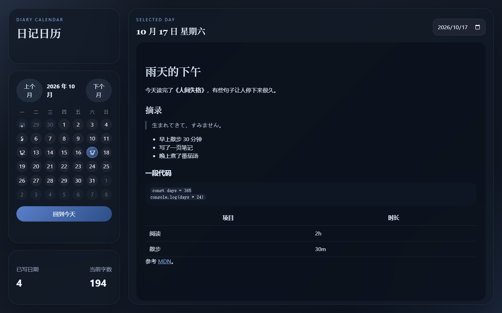
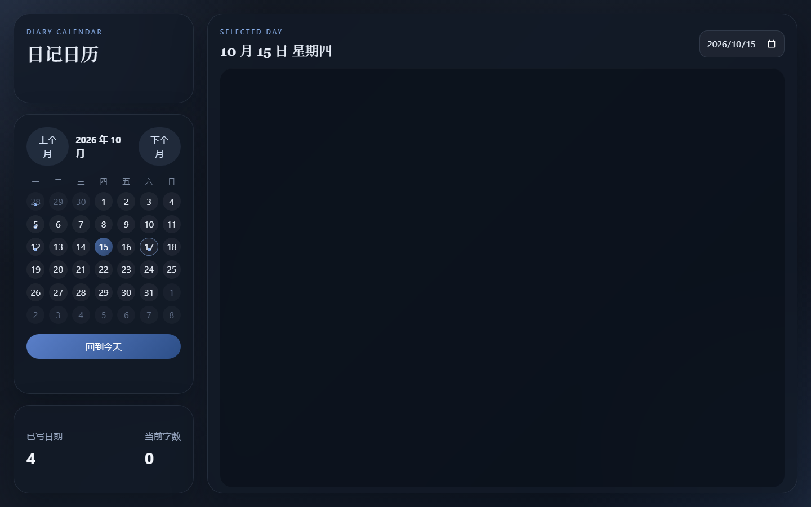
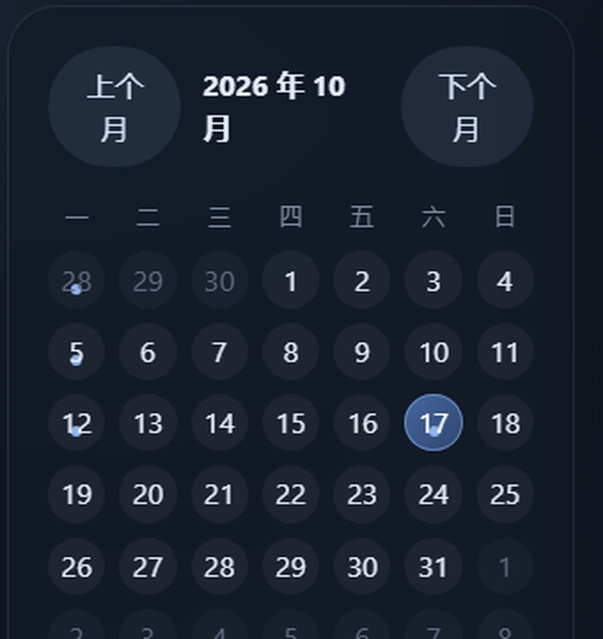
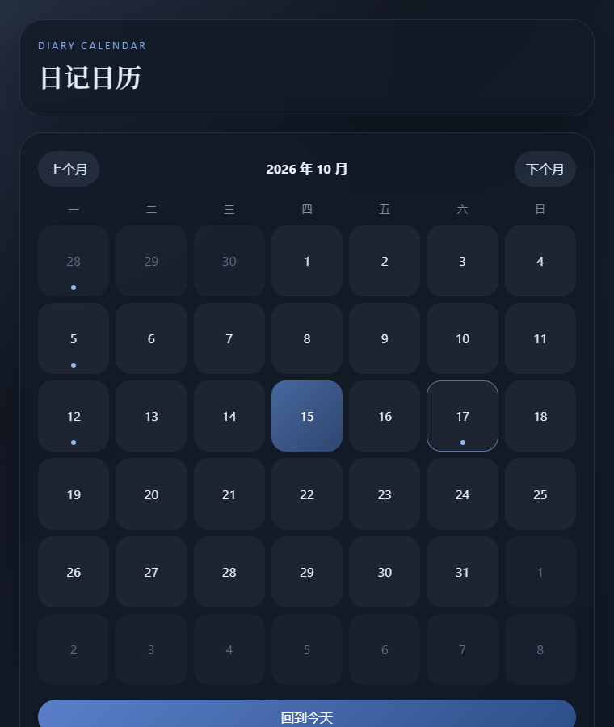

# 日记日历（diary-calendar-app）· 项目审查报告

> 审查对象：`D:\项目\日记`　|　审查方式：全量源码走读 + 生产构建复现 + 无头浏览器实测 + 安装包/asar 解包核对
> 代码规模：源码 728 行（5 个文件）、配置 73 行　|　运行时依赖 4 个　|　git 提交 4 次
> 审查日期：2026-10-17

> **状态说明：本报告记录的是修复前的状态。**
> 报告中的 P0/P1 问题与主要视觉缺陷已在后续提交中修复，逐条对照见 [修复说明.md](修复说明.md)。
> 本文截图保留为「修复前」对照，新界面见 `review/screenshots/after/`。

---

## 一、结论摘要

这是一款**完成度不错、视觉成熟、但数据可靠性偏弱**的本地日记应用。技术选型克制（Vue 3 + Vite + Electron + 4 个运行时依赖），单文件组件就能讲清楚全部逻辑，没有过度抽象，符合 `.github/copilot-instructions.md` 里"避免无意义复杂抽象"的自我约束。

它已经是一个**能每天用的工具**——磁盘上确实躺着 13 篇真实日记（2026-03-28 至 2026-06-12），说明它被实际使用过。但它还不是一个**可以放心托付十年数据的产品**：写入不是原子的、没有备份、没有导出、异常时整表静默回退、关窗会吞掉最后一次输入、点一个链接就能让应用被导航走并顺带把日记读取接口暴露给远程页面。

| 维度 | 评分 | 一句话 |
| --- | --- | --- |
| 架构设计 | ★★★★☆ | 主/渲染分离干净，IPC 面极小，数据存明文 Markdown 是加分项 |
| 代码质量 | ★★★☆☆ | 逻辑清晰，但边界处理（空日期、异常、闭窗）缺失 |
| 数据可靠性 | ★★☆☆☆ | 非原子写、无备份/导出、失败静默、无单实例锁 |
| 安全性 | ★★★☆☆ | Electron 默认项开得对、XSS 双层防护有效，但导航未拦截 |
| 视觉与交互 | ★★★☆☆ | 气质好，但默认窗口下日历头部就是断的，多处 CSS 细节失配 |
| 可访问性 | ★★☆☆☆ | 编辑区无法用键盘进入，日期按钮无标签，浅色数字对比度 3.01:1 |
| 工程化 | ★☆☆☆☆ | 无 lint / 无测试 / 无 CI / 无类型 |
| 打包发布 | ★★☆☆☆ | 能出安装包，但是 Electron 默认图标与"GitHub, Inc."元数据，更新清单是坏的 |
| 文档 | ★★☆☆☆ | README 仍写"localStorage 自动保存"，与实现不符 |

**最该先修的 5 件事**

1. 点正文里的链接会把整个应用导航走，且远程页面仍带着 preload 桥接——可以读取全部日记（`electron/main.cjs` 无 `will-navigate` 拦截）。
2. 关窗口 / 切日期时，最后 240 ms 的输入会丢（防抖定时器只 `clearTimeout` 不 flush）。
3. 写入非原子、无备份、无导出——一次断电就可能是半截文件。
4. `entries:list` 只要有一个文件读失败，整张表回退成 localStorage 空表，界面显示"没写过"，用户再输入就覆盖。
5. 把日期输入框清空，标题直接变成 `Invalid Date`，之后所有写入被主进程拒绝且无任何提示（已实测复现）。

---

## 二、项目事实

### 2.1 技术栈

| 层 | 选型 | 版本 |
| --- | --- | --- |
| 渲染 | Vue 3（`<script setup>`） | ^3.5.13 |
| 构建 | Vite + `@vitejs/plugin-vue` | ^6.2.2 |
| 桌面 | Electron | ^35.0.2（实际安装 35.7.5） |
| 打包 | electron-builder（NSIS） | ^25.1.8 |
| 库 | dayjs / markdown-it / dompurify | 1.11 / 14.1 / 3.2 |

无 TypeScript、无路由、无状态库、无 UI 框架——全部手写 CSS，共 338 行。

### 2.2 目录与职责

```
日记/
├─ index.html              入口（12 行，lang=zh-CN，无 CSP）
├─ vite.config.js          base:'./' 关键项——让 file:// 下的相对资源可用
├─ electron/
│  ├─ main.cjs             106 行：窗口 + 3 个 IPC handler
│  └─ preload.cjs          14 行：contextBridge 暴露 desktopApp
├─ src/
│  ├─ App.vue              265 行：全部业务（日历 + 编辑 + 渲染 + 统计）
│  ├─ style.css            338 行：设计系统 + 全部样式
│  └─ main.js              5 行
├─ dist/                   Vite 产物（git 忽略）
├─ released/               electron-builder 产物（git 忽略）
└─ .github/copilot-instructions.md   4 行项目约定
```

### 2.3 数据模型

- 一篇日记 = 一个文件：`%APPDATA%\diary-calendar-app\entries\YYYY-MM-DD.md`
- 内容为 UTF-8 无 BOM、LF 换行的纯 Markdown（已核对现存 13 个文件）
- 空内容 = 删除文件（`main.cjs:51-61`）
- 浏览器环境降级为 `localStorage['diary-calendar-entries']`（`App.vue:21-27`）

这个设计方向很好：数据是明文、可迁移、可被 Obsidian / grep / git 直接消费，寿命远长于应用本身。

### 2.4 迭代轨迹

| 提交 | 内容 |
| --- | --- |
| `dcefbd6` first version | 骨架落地：日历 + 编辑 + 打包配置 |
| `d235e31` chore: remove packaged artifacts | 把产物移出版本库，改 `base:'./'` |
| `3dd96c5` new version | 视觉重做（样式 +100/−52） |
| `9cc7dba` add data | 从 localStorage 迁移到主进程文件存储（+145） |

最后一次提交是架构分水岭：数据从"浏览器容器"搬到了"用户磁盘"，这也是"数据可靠性"话题从此开始变得重要的地方。

---

## 三、架构走读

### 3.1 进程模型

```
┌─────────────────────────┐        ┌──────────────────────────────┐
│ Renderer (Vue)          │        │ Main (Node)                  │
│  App.vue                │  IPC   │  main.cjs                    │
│  entries: Map<date,str> │ ─────► │  entries:list   readdir+read │
│  防抖 240ms 落盘         │ ◄───── │  entries:write  write/unlink │
└─────────────────────────┘        │  entries:getDirectory        │
        ▲                          └──────────────────────────────┘
        │ contextBridge（`window.desktopApp`）
     preload.cjs
```

**做得对的地方**：`contextIsolation: true` + `nodeIntegration: false` + 只经 preload 暴露 3 个方法，IPC 面极小；日期参数用 `/^\d{4}-\d{2}-\d{2}$/` 严格校验后才拼路径（`main.cjs:14-21`），**杜绝了 `../` 路径穿越**——这是很多同类项目会踩的坑。

**结构性缺陷**：渲染层是"全量内存表 + 整表持久化"的心智模型，主进程却是"单文件增量写"。两者语义不一致，导致降级路径（`writeEntry` 在浏览器模式持久化整个 `entries`）与桌面路径（只写一个文件）行为不同，异常时容易分叉。

### 3.2 数据流与保存时机

一次输入的完整链路：

```
键入 → v-model 更新 currentEntry（setter 展开整个 entries 对象）
     → watch(currentEntry) 触发（App.vue:128）
     → 清旧定时器，起 240ms 新定时器，捕获当时的 activeDate
     → 到期 writeEntry(date, content) → IPC → fs.writeFile
```

保存时机共有 3 个触发点：防抖到期、`persistNow`（切日期时，`App.vue:156`）、`leaveEditing`（失焦时，`App.vue:177`）。

`selectDate` 的设计是"先存旧日期再切"，实测**快速切日期不会丢内容**（见 §4.3），这部分逻辑是对的。

### 3.3 渲染安全

`markdown-it({ html: false })` + `DOMPurify.sanitize()` 双层（`App.vue:12-17, 143-145`）。实测注入 ``、`<script>`、`[x](javascript:...)` 全部被拦截，DOM 中无 `img`/`script`，`javascript:` 链接的 `href` 被清空。**这一层是可靠的**。

---

## 四、实测验证

### 4.1 构建

| 项目 | 结果 |
| --- | --- |
| `npm run build` | ✅ 通过，94 modules，1.41 s |
| 产物 | `index-Ce1fpxxc.js` 202.39 kB（gzip 85.43 kB）、`index-YAEMENpT.css` 4.27 kB（gzip 1.69 kB） |
| 与 `dist/` 现有产物 | 哈希一致，说明工作区代码与最近一次构建同步 |

> 注：受限沙箱下构建会因 esbuild 子进程管道限制报 `spawn EPERM`，这是环境限制，不是项目问题——在不受限环境下构建正常。

### 4.2 安装包核对

| 项目 | 结果 |
| --- | --- |
| 安装包 | `released/日记日历-Setup-0.1.0.exe`，87.86 MB |
| 解包 Meta | `released/win-unpacked/日记日历.exe`，201 MB |
| asar | 18.9 MB / 1204 个条目 |
| 一致性 | asar 内 `main.cjs`、`preload.cjs`、`dist/index.html` 与工作区**逐字节相同** ✅ |
| exe 元数据 | `FileDescription=Electron`、`ProductName=Electron`、`CompanyName=GitHub, Inc.` ❌ |

### 4.3 行为探测

用无头 Chrome 驱动真实构建产物（浏览器降级模式）执行断言，原始结果见 `review/behaviour.json`：

| 探测项 | 结果 | 结论 |
| --- | --- | --- |
| 空日期是否有引导文案 | `.empty-state` 文本 = `""` | ❌ 空白区域毫无提示 |
| 编辑器 placeholder | `null` | ❌ 无占位符 |
| 输入后 400 ms 落盘 | `{"2026-10-17":"第一行内容"}` | ✅ 防抖保存正常 |
| 输入后立刻切日期 | 旧日期内容完整保留 | ✅ 切日期不丢数据 |
| `` 注入 | DOM 无 `img`，`window.__xssImg` 未触发 | ✅ 安全 |
| `<script>` 注入 | DOM 无 `script`，未执行 | ✅ 安全 |
| `javascript:` 链接 | `href=null`，点击标志未触发 | ✅ 安全 |
| 清空日期输入框 | 标题显示 `Invalid Date` | ❌ 状态机未兜底 |

### 4.4 界面实测

| 读模式（1440×920 默认窗口） | 编辑模式 |
| --- | --- |
|  |  |

| 日历头部放大（问题现场） | 窄屏单列（760px） |
| --- | --- |
|  |  |

---

## 五、问题清单

分级：**P0** 会丢数据或有安全风险　**P1** 明确的功能/交互缺陷　**P2** 视觉与体验　**P3** 工程化与可维护性

### P0 — 数据与安全

#### P0-1　点击链接会把应用导航走，并把日记读取接口交给远程页面
`electron/main.cjs:71-90`

`webPreferences` 里没有 `will-navigate` / `setWindowOpenHandler`，markdown 渲染出的 `<a href="https://...">` 会在**同一个 BrowserWindow 内直接导航**。后果有两层：

1. 用户点一下日记里的链接，应用界面被网页顶替，没有返回按钮，只能重启；
2. 更严重的是——**preload 会在每次导航后重新注入**，远程页面同样拿到 `window.desktopApp.entries`，可以直接 `list()` 读走全部日记、`write()` 覆盖。

```js
// electron/main.cjs —— 建议补上
const { shell } = require('electron')

window.webContents.setWindowOpenHandler(({ url }) => {
  shell.openExternal(url)
  return { action: 'deny' }
})
window.webContents.on('will-navigate', (event, url) => {
  const appUrl = process.env.VITE_DEV_SERVER_URL
  if (appUrl && url.startsWith(appUrl)) return
  event.preventDefault()
  if (/^https?:/i.test(url)) shell.openExternal(url)
})
```

#### P0-2　关窗口 / 卸载时最后 240 ms 的输入被丢弃
`src/App.vue:76-80`、`src/App.vue:128-141`

```js
onBeforeUnmount(() => {
  if (saveTimer.value) clearTimeout(saveTimer.value)   // ← 只清理，不落盘
})
```

用户在写完最后一个字后直接按关闭，定时器被清掉，那次输入永远不会写盘。且窗口销毁时 `onBeforeUnmount` 未必执行，风险更高。

```js
// 建议：卸载/卸载前先 flush
const flush = () => { if (saveTimer.value) persistNow(selectedDate.value).catch(console.error) }
onBeforeUnmount(flush)
window.addEventListener('beforeunload', flush)
```

#### P0-3　写入非原子、无备份、无导出
`electron/main.cjs:63`

`fs.writeFile` 是"截断再写"。断点、蓝屏、磁盘满都会留下半截文件，而应用没有任何历史版本可回滚。对一个"只增不减"的日记来说，这是最不该省的地方。

```js
// 建议：临时文件 + rename（同盘内 rename 近似原子）
const tmp = filePath + '.tmp'
await fs.writeFile(tmp, content, 'utf8')
await fs.rename(tmp, filePath)
```

同时建议：每天首次启动时把 `entries/` 打一个 zip 到 `backups/`，保留最近 7 份——二十行代码就能挡掉 90% 的灾难。

#### P0-4　一个坏文件会导致整表"看起来被清空"
`electron/main.cjs:23-41` + `src/App.vue:50-57, 65-74`

`entries:list` 用 `Promise.all` 读所有文件，任一文件抛错（权限、编码、被其他程序占用）整个 IPC 失败；渲染层 `catch` 后静默回退到 `safeParseEntries()`——通常是 `{}`。于是**用户看到所有日记都没了**，接着随手写一句，就把真实数据覆盖成一条。

修复：单个文件 try/catch，坏文件跳过并回传警告列表；渲染层在回退时给出显著提示，且**回退到空表时禁止写入**。

#### P0-5　无单实例锁
`electron/main.cjs:92-106`

双击两次图标就两个进程写同一批文件，后写覆盖先写。加 `app.requestSingleInstanceLock()` 即可。

### P1 — 功能与交互缺陷

#### P1-1　清空日期输入框后应用进入 `Invalid Date` 状态
`src/App.vue:242`（`<input type="date" v-model="selectedDate">`）

已实测复现：把日期框清空 → 标题显示字面量 `Invalid Date`；此后每次输入都会调用 `writeEntry('', content)`，主进程 `toFilePath` 抛 `Invalid date format`，错误只进 `console.error`，用户完全无感——**写了字，以为保存了，其实没有**。

修复：`watch(selectedDate)` 里判断 `dayjs(value).isValid()`，无效则回退到今天；输入框加 `min/max`。

#### P1-2　空日期没有任何引导
`src/App.vue:260`

`.empty-state` 是个纯空 `div`，textarea 也没有 placeholder。新用户点进某一天，看到的是一整块深色空白，不知道"点一下就能写"。建议加一行灰色提示：「点此开始写今天的日记」+ textarea placeholder。

#### P1-3　没有保存状态反馈
用户无法判断"存没存上"，尤其在这种"无按钮、自动保存"的交互里。建议在面板头部放一个低调的状态位：`已保存 · 21:03` / `保存中…` / `保存失败，重试`。

#### P1-4　编辑区无法用键盘进入
`src/App.vue:245`

`<div class="compose-body" @click="...">` 不是可聚焦元素，纯键盘用户永远进不了编辑态。加 `tabindex="0"` + `@keydown.enter` + `role="textbox"`，或直接放一个"编辑"按钮。

#### P1-5　无 `Ctrl+S` / `Esc`
失焦才退出编辑，写长文时很容易误触外面就切换成预览。建议 `@keydown.esc` 退出、`@keydown.ctrl.s` 立即持久化。

### P2 — 视觉与体验（均有截图为证）

#### P2-1　默认窗口下日历头部是"断"的
`src/App.vue:192-196`、`src/style.css:110-124`

侧栏固定 320px，三个元素（上个月 / 月份 / 下个月）挤不下：文字被拆成「上个↵月」「2026 年 10↵月」「下个↵月」。**这是默认窗口尺寸下必然出现的缺陷**，不是极端情况。

修复：按钮改成 `‹` `›` 图标；月份 `white-space: nowrap`；或侧栏加宽到 340–360px。

#### P2-2　"有日记"的小圆点压在日期数字上
`src/style.css:166-176`

`bottom: 8px` + 单元格 `aspect-ratio: 1`（约 45px 高）时，圆点正好落在数字底部，视觉上像数字缺了一块。建议 `bottom: 4px`、缩到 4px，或给数字加 `padding-bottom` 把基线抬高。

#### P2-3　代码块出现"双层底色"
`src/style.css:274-286`

`.markdown-body code` 的内联样式（padding + 圆角 + 浅底）同样作用于 `pre > code`，形成灰底方块套深色方块。补一条：

```css
.markdown-body pre code { padding: 0; background: none; border-radius: 0; }
```

#### P2-4　表格表头居中、正文靠左
`src/style.css:306-310`：`th` 默认居中，`td` 默认左对齐，一列两制。补 `text-align: left`。

#### P2-5　品牌卡片被栅格拉出一大块空白
`src/style.css:50-58`：`.sidebar` 是 `display:grid`，三行 auto 在 100vh 内被拉伸，于是"日记日历"标题下方多出约 100px 空白。加 `align-content: start` 即可。

#### P2-6　启动瞬间白闪
`electron/main.cjs:77`：`backgroundColor: '#f7f3eb'`（浅米色）与深色主题不符，窗口先白后黑。

#### P2-7　响应式断点在桌面端基本是死代码
窗口 `minWidth: 1080`，而断点是 1100px / 720px——单列布局只在 1080–1100 这 20px 区间触发，720px 断点永远不可达。

#### P2-8　`today` 在模块加载时固化
`src/App.vue:11`：应用开着跨过零点，"今天"高亮和"回到今天"仍指向昨天。

#### P2-9　字数统计把 Markdown 语法算进去
`src/App.vue:147-149`：`#`、`**`、`|` 都计入，"当前字数"会虚高。

#### P2-10　统计口径含糊
"已写日期"是全库累计，不随月份变化，容易被误读为"本月已写"。

### P3 — 工程化与打包

| # | 问题 | 证据 / 位置 |
| --- | --- | --- |
| P3-1 | **没有应用图标**，exe 元数据仍是 Electron 官方信息 | `build/` 目录不存在；`FileDescription=Electron`、`CompanyName=GitHub, Inc.`；`signAndEditExecutable:false` 使 builder 无法写入图标与版本信息 |
| P3-2 | **自动更新清单是坏的** | `released/latest.yml` 指向 `diary-calendar-app-setup-0.1.0.exe`，实际文件名为 `日记日历-Setup-0.1.0.exe`；`app-update.yml` 指向 `qinghuan-yu/Minimalist-Calendar`，但代码里没有任何 `autoUpdater`，`package.json` 也没有 `publish` 字段 |
| P3-3 | **脏产物进了安装包** | `dist/` 残留 9 个历史产物（1,226,781 B ≈ 1.2 MB），已确认全部被打进 `app.asar`；`build` 脚本没有 clean 步骤 |
| P3-4 | 无 lint / format / 测试 / CI | 无 `.eslintrc`、`.prettierrc`、`vitest`，`.github/` 下只有一份 copilot 约定，没有 workflow |
| P3-5 | README 与实现脱节 | `README.md:10` 仍写"本地 localStorage 自动保存"，实际已是主进程文件存储；`README.md:36-49` 的"当前验证结果"也停留在早期 |
| P3-6 | 无 CSP | `index.html` 无 CSP meta，Electron 会在控制台告警；结合 P0-1 尤其值得补 |
| P3-7 | 未开启 `sandbox: true` | `main.cjs:78-82`，preload 只用 contextBridge，完全可以开 |
| P3-8 | 默认英文菜单 | 未 `Menu.setApplicationMenu`，中文应用顶着 File/Edit/View/Help |
| P3-9 | 无 `app.setAppUserModelId` | 任务栏分组/通知身份缺失（Windows） |
| P3-10 | `.gitignore` 同时有 `release/` 与 `released/` | 实际输出目录只有 `released/` |
| P3-11 | `package.json` 缺 `description`/`author`/`license` | 打包告警，NSIS 发布者信息为空 |
| P3-12 | 死代码 | `preload.cjs:4-8` 的 `versions`、`main.cjs:67-69` 的 `entries:getDirectory` 都暴露了但界面未用 |
| P3-13 | 变量遮蔽 | `main.cjs:72` 局部变量命名为 `window`，遮蔽全局，建议 `win` |

### 可访问性

| # | 问题 | 数据 |
| --- | --- | --- |
| A-1 | 编辑区无法键盘进入 | `div` + `@click`，无 `tabindex`/`role` |
| A-2 | 日期按钮无 `aria-label` / `aria-pressed` | 42 个按钮只有裸数字 |
| A-3 | "有日记"仅靠视觉圆点传达 | 无 `aria` 描述，读屏用户完全感知不到 |
| A-4 | 非本月日期对比度不足 | `#5f6d85` on `#1c2331` = **3.01:1**（WCAG AA 正文要求 4.5:1） |
| A-5 | 无 `prefers-reduced-motion` 处理 | `.ghost-btn:hover` 等有位移过渡 |

> 对比度实测：正文 13.89:1、周几标签 5.19:1、统计标签 6.93:1、eyebrow 7.71:1——**除了非本月日期，其余全部达标**，说明配色本身是有意设计的，只是 muted 色深了一档。

---

## 六、安全与隐私评估

**已经做对的**

- `contextIsolation: true`、`nodeIntegration: false`
- IPC 只暴露 3 个方法，无 `ipcRenderer` 直通
- 日期白名单正则，无路径穿越
- `html: false` + DOMPurify 双层，实测 XSS 全被拦截
- 数据落在用户目录明文，不联网、无遥测

**缺口**

1. **导航未拦截**（P0-1）——最需要优先修，等于把 3 个 IPC 方法交给任意网页。
2. **无 CSP**——一旦将来放宽 markdown 的 `html`，没有第二道防线。
3. **日记无任何加密或锁**——本地明文，同机其他账户/进程可读。对"日记"这个品类，建议至少提供可选的密码锁（简单方案：AES-GCM + 密码派生密钥），或至少提供"隐私模式"（失焦模糊 + 快捷键隐藏窗口）。
4. **无 `sandbox: true`**，preload 已经是纯 bridge，没有不开的理由。

---

## 七、打包与发布评估

**现状**：能稳定出 NSIS 安装包（87.86 MB），asar 内容与源码一致，`base: './'` 处理得当，`signAndEditExecutable: false` 绕开了无签名证书时的编辑失败——这些都是务实的选择。

**但产物看起来不像一个"产品"**：

- 图标是 Electron 默认图标，文件属性里写着"Electron / GitHub, Inc."；
- 自动更新清单文件名对不上，且根本没有更新代码——现在这份 `latest.yml` 只会误导人去配更新服务；
- 1.2 MB 死产物进了包；
- `directories.buildResources` 指向不存在的 `build/` 目录。

**建议的最小动作**：放一张 256×256 的 `build/icon.ico` → 打开 `signAndEditExecutable`（有图标后才有意义）→ 补 `nsis.oneClick: false`（让用户能选安装位置）→ 要么补上 `autoUpdater`，要么把 `app-update.yml` 与 `latest.yml` 从产物里去掉，别留半成品。

---

## 八、值得肯定的设计

1. **数据格式选得对**：一天一个 `.md`，纯文本。应用没了，数据还在；换个编辑器照样能读。这是日记类软件最重要的架构决策，做对了。
2. **克制**：4 个运行时依赖、728 行源码解决问题，没有引入 Pinia/Router/Element Plus。对单人小工具来说这是优点。
3. **渲染安全有两层**，且实测有效。
4. **IPC 设计最小**：3 个方法，语义清晰，参数校验前置。
5. **视觉语言统一**：玻璃拟态 + 深蓝夜色 + 衬线标题，字号/圆角/留白有系统感，`prefers` 之外还照顾了 `font-synthesis`、`text-rendering` 这些细节。
6. **`.github/copilot-instructions.md`** 这类"给协作方（人或 AI）的约定"是成熟做法。

---

## 九、改进路线图

### 第一阶段：守住数据（半天 ~ 1 天）

| 任务 | 改动量 |
| --- | --- |
| 修补 P0-1 导航拦截 | `main.cjs` +10 行 |
| 修补 P0-2 卸载/关闭 flush | `App.vue` +4 行 |
| 修补 P0-3 原子写 | `main.cjs` +3 行 |
| 修补 P0-4 单文件容错 + 失败提示 | `main.cjs` +10 行，`App.vue` +8 行 |
| 修补 P0-5 单实例锁 | `main.cjs` +8 行 |
| 修补 P1-1 空日期兜底 | `App.vue` +6 行 |

这一阶段做完，应用就从"demo 级可靠"进入"可以天天写"。

### 第二阶段：体验补齐（2 ~ 3 天）

- 侧栏工具条布局、圆点位置、代码块、表头、品牌卡空白（P2-1 ~ P2-5）
- 空态文案 + placeholder + 保存状态（P1-2、P1-3）
- 快捷键 `Ctrl+S` / `Esc`（P1-5）
- 应用图标 + exe 元数据 + 中文菜单 + `backgroundColor`（P3-1、P3-8、P2-6）
- "打开数据目录"入口（`entries:getDirectory` 已经写好了，接一个按钮即可）
- 导出（打包 zip / 导出全部为单个 Markdown）

### 第三阶段：工程化与长期演进（1 周）

- ESLint + Prettier + Vitest（先给 `dateFilePattern`、日历网格生成、Markdown 渲染上 3 个单测）
- GitHub Actions：`build` + `build:desktop` 冒烟
- CSP meta + `sandbox: true`
- 清理 `dist`（加 `rimraf dist` 到 build 前）+ 修 `latest.yml` 或删掉更新相关产物
- README 重写（数据在哪、怎么备份、怎么迁移）
- 产品向：全文搜索、标签/心情、图片粘贴、按月/年回顾、可选的密码锁

---

## 十、附：审查方法与可复现性

| 步骤 | 命令 / 手段 |
| --- | --- |
| 源码走读 | 全量阅读 5 个源文件 + 4 份配置 |
| 构建复现 | `npm run build`（Vite 6.4.1，94 modules，1.41 s） |
| 产物比对 | `@electron/asar` 解包，逐文件 sha256 对比工作区 |
| 界面实测 | 无头 Chrome + CDP，1440×920 / 760×900 两档截图 |
| 行为断言 | CDP 注入真实输入事件，验证防抖保存、切日期、XSS、空日期 |
| 数据核对 | 只读扫描 `%APPDATA%\diary-calendar-app\entries`（13 篇，编码/换行/大小） |
| 元数据核对 | `FileVersionInfo` 读取 exe 属性；`latest.yml` / `app-update.yml` 对照实际文件名 |

> 说明：本次审查只读不写业务代码，未修改任何源文件；`dist/` 由一次正常的 `npm run build` 刷新（内容与原有产物哈希一致）。
